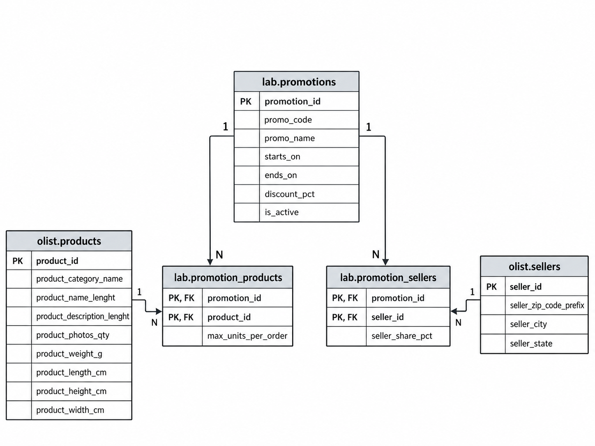

# Практическая работа №8 — ER-модель и расширение предметной области

**Вариант 3: «Промоакции».**

В работе предметная область Olist расширена сущностями промоакций. Данные Olist не дублируются: новые таблицы связаны с существующими `olist.products` и `olist.sellers` через внешние ключи.

## Состав решения

В папке `lab08` находятся:

- `erDiagram.png` — ER-диаграмма новой модели;
- `lab08.sql` — создание таблиц, ограничений и тестовых данных;
- `README.md` — краткое описание модели и результаты проверки.

## Созданные таблицы

### 1. `lab.promotions`
Справочник промоакций:
- `promotion_id` — первичный ключ;
- `promo_code` — уникальный код промоакции;
- `promo_name` — название;
- `starts_on`, `ends_on` — период действия;
- `discount_pct` — процент скидки;
- `is_active` — признак активности.

### 2. `lab.promotion_products`
Связующая таблица между промоакциями и товарами Olist:
- `promotion_id` — часть составного PK и FK на `lab.promotions`;
- `product_id` — часть составного PK и FK на `olist.products`;
- `max_units_per_order` — ограничение на число единиц товара в одном заказе.

### 3. `lab.promotion_sellers`
Связующая таблица между промоакциями и продавцами Olist:
- `promotion_id` — часть составного PK и FK на `lab.promotions`;
- `seller_id` — часть составного PK и FK на `olist.sellers`;
- `seller_share_pct` — доля продавца в рамках промоакции.

## Ключи и ограничения

### Первичные ключи
- `pk_promotions`
- `pk_promotion_products`
- `pk_promotion_sellers`

### Внешние ключи
- `fk_promotion_products_promotion`
- `fk_promotion_products_product`
- `fk_promotion_sellers_promotion`
- `fk_promotion_sellers_seller`

### Уникальность
- `uq_promotions_promo_code`

### Проверки (`CHECK`)
- `ck_promotions_date_range` — дата окончания не раньше даты начала;
- `ck_promotions_discount_pct` — скидка в допустимом диапазоне;
- `ck_promotion_products_max_units` — положительное число единиц;
- `ck_promotion_sellers_share` — доля продавца в диапазоне 0–100.

### Обязательные поля (`NOT NULL`)
Используются в каждой новой таблице. По результатам проверки создано **13 обязательных столбцов**.

## Связи и кратности

- `promotions 1 : N promotion_products`
- `products 1 : N promotion_products`
- `promotions 1 : N promotion_sellers`
- `sellers 1 : N promotion_sellers`

Следовательно, связи:
- `promotions ↔ products` — **M:N** через `promotion_products`;
- `promotions ↔ sellers` — **M:N** через `promotion_sellers`.

## Тестовые данные

Скрипт автоматически вставляет:
- **5 строк** в `lab.promotions`;
- **5 строк** в `lab.promotion_products`;
- **5 строк** в `lab.promotion_sellers`.

Для таблиц связей используются реальные `product_id` и `seller_id`, выбранные из Olist, поэтому внешние ключи проверяются на реальных данных.

## Намеренно ошибочные операции

В `lab08.sql` оставлены закомментированные примеры ошибочных операций, которые должны нарушать ограничения, например:
- скидка больше допустимого диапазона;
- некорректный интервал дат;
- несуществующий `product_id`;
- повтор `promo_code`.

Это демонстрирует работу `CHECK`, `FK` и `UNIQUE`.

## Фактические результаты выполнения

По результатам запуска `lab08.sql` получено:

- `promotions_count = 5`
- `promotion_products_count = 5`
- `promotion_sellers_count = 5`
- `invalid_product_fk_rows = 0`
- `invalid_seller_fk_rows = 0`
- `named_integrity_constraints = 25`

Также в выводе `information_schema` подтверждено:
- наличие **PK / FK / UNIQUE / CHECK** ограничений;
- наличие **13 NOT NULL** столбцов;
- корректность ссылок на реальные товары и продавцов Olist.

## Вывод

Для варианта 3 построена ER-модель подсистемы промоакций и реализована в PostgreSQL. Новая модель не дублирует данные Olist, а расширяет существующую БД через внешние ключи. Все ограничения целостности созданы и успешно проверены, тестовые данные загружены, а ER-диаграмма отражает состав сущностей, ключи и связи модели.
